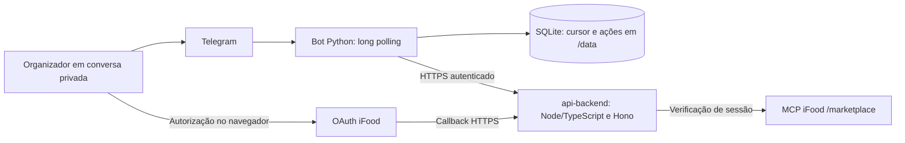

# Arquitetura implementada

Incremento BOT-01: o [fluxo de outbox/worker](bot-01-fila-duravel.md) acrescenta tabelas ao SQLite do bot e comunica as rotas v1 da RUN-01/DATA-01. Não duplica o domínio na API nem instala modelo. O fluxo de login e seu histórico abaixo permanecem separados; a conversa é opt-in, não ativada neste desenvolvimento.

Esta página combina o mapa histórico de login com a integração BOT-01/BOT-02. A conversa usa o contrato v1 implementado; a [proposta v0](contrato-conversa-proposto.md) é histórica. Modelo e domínio por pessoa já estão integrados na API, com configuração explícita. O [plano vigente](plano-conversacional.md) exige carrinho real confirmado; CART-01 e callback PREPARE_CART ainda dependem de integração/INT-02. Envio e pagamento seguem proibidos.

[Índice](README.md) · [Estado e evidências](estado-atual.md)

## Fronteiras atuais

O diagrama acima mostra o login implementado e seu ensaio histórico. A conversa acrescenta runner → outbox SQLite → API RUN-01/AI-02/DATA-01 → consulta e apresentação; BOT-02 retoma o grupo por GET após revalidar o vínculo. O bot ainda não implementa confirmação PREPARE_CART. Consultar [remoto/local](estado-remoto-local.md) para separar integração de código, evidência operacional e CART-01 local. O protótipo FastAPI original é outro serviço.

## Mapa do código

| Módulo | Responsabilidade implementada |
| --- | --- |
| `src/telegram_bot/__main__.py` | CLI, configuração, diagnóstico Telegram, inicialização e encerramento |
| `config.py` | Token Telegram, ID permitido e diretório de estado pelo ambiente |
| `telegram.py` | Transporte Bot API, métodos permitidos, timeout, bloqueio de redirects e erros saneados |
| `runner.py` | Autorização da conversa/remetente, comandos, callbacks, polling e espera progressiva |
| `state.py` | Cursor SQLite, registro prévio de ações e lock de processo no mesmo diretório |
| `backend.py` | Contrato HTTP de login, validação de estados, operações e URL de autorização |
| `connections.py` | Mensagens do fluxo, apresentação da identidade mascarada e botão humano |
| `conversation.py` | Cliente v1.0 de eventos, consultas e cancelamento local, utilizado pela outbox/worker |
| `outbox.py` / `conversation_runner.py` | Persistência dos eventos, acompanhamento sem bloquear polling e retomada por consulta |
| `conversation_contract.py` | Documentos imutáveis, schemas fixados e validação semântica de respostas |
| `tests/test_bot.py` | Cenários simulados do canal, transporte, autorização e estado |
| `tests/test_connections.py` | Cenários simulados do contrato, confirmação, replay e falhas |
| `Dockerfile` / `railway.toml` | Imagem Python 3.12 e configuração do worker |

OAuth, MCP, modelo, regras do grupo e escrita de carrinho pertencem à API. O adaptador envia eventos do organizador e apresenta respostas confiáveis; não duplica o domínio nem executa ferramentas iFood diretamente.

O [cliente de conversa](cliente-conversa.md) já está conectado ao runner via outbox BOT-01, com opt-in explícito. Esse código integrado não comprova ensaio humano ponta a ponta. Confirmação de carrinho exige o caminho dedicado CART-01/BOT-03 e nunca é inferida do texto do modelo.

## Contrato HTTP consumido

Origem HTTPS configurada em `BACKEND_BASE_URL`. Headers: `Authorization: Bearer BACKEND_API_TOKEN` e `X-Telegram-User-Id` do organizador validado pelo adaptador. A identidade não vem de texto ou modelo.

| Ação do bot | Método e rota | Efeito |
| --- | --- | --- |
| `/conectar` | `POST /api/bot/ifood/connect` | Nova tentativa de login; pode substituir a anterior |
| `/confirmar` e `/ifood` | `GET /api/bot/ifood/status` | Consulta local do vínculo; `/confirmar` apresenta o botão quando disponível |
| Clique em Confirmar conexão | `POST /api/bot/ifood/confirm` | Envia o `confirmationId` da tentativa atual após validação humana |
| `/verificar` | `POST /api/bot/ifood/verify` | Solicita verificação/renovação ao backend |

BOT-02 consome também POST /api/bot/ifood/cancel e DELETE /api/bot/ifood/link, com efeitos separados. Consultas automáticas de status atualizam a mensagem de login. Rotas de avaliação e endereços continuam fora do adaptador. O [contrato de referência](https://github.com/Modo-Escuro/api-backend/blob/686300d1a10c12bb6c3bd899e40fbd3a68c648f5/docs/bot-api.md) também descreve essas rotas do backend; existência na API não significa comando entregue no bot.

O timeout HTTP do backend é de 50 segundos nos comandos e 5 segundos nas consultas automáticas; não há retry automático de mutações. O cliente rejeita redirect e link de autorização fora da origem pública configurada ou sem correspondência com a tentativa.

## Estado e repetição

Antes de conexão, verificação, confirmação, cancelamento ou desconexão, o adaptador grava o `update_id` como ação iniciada. Replay do mesmo update consulta o estado em vez de repetir a mutação. O cursor avança após resposta ou descarte autorizado do evento; falha entre envio Telegram e gravação pode repetir mensagem textual.

O `confirmationId` não é persistido no SQLite: vem do status e do callback do botão. Clique antigo não confirma uma tentativa nova. Uso único e validade também dependem da autoridade do backend. O lock protege processos no mesmo diretório; não impede outra máquina de usar o mesmo token.

O SQLite contém cursor, IDs de ações e uma tentativa acompanhada (organizador, attemptId, messageId, fase e prazos), sem texto de mensagens ou credenciais. No backend, tokens iFood pertencem ao vínculo confirmado, fora do modelo e do bot. A persistência online da API ainda precisa de volume, conforme [estado atual](estado-atual.md).

## Regras para os próximos incrementos

As garantias de repetição do canal não equivalem à idempotência de um pedido remoto. O contrato de compra deverá vincular intenção, responsável, conta/link, versão, total em centavos e validade; alterações invalidam aprovação. Timeout remoto exige reconciliação antes de reenviar.

Restrições obrigatórias e informação alimentar desconhecida precedem ranking. Catálogo é dado, não instrução. Consulte [regras preservadas](regras-preservadas.md) e [plano da demo](plano-demo.md) antes de implementar novos fluxos.
