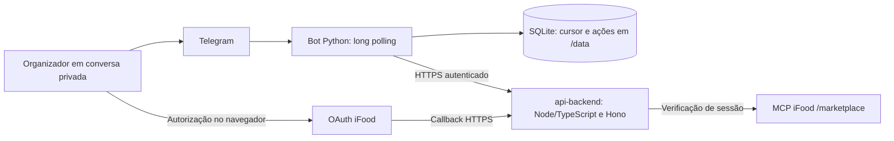

# Arquitetura implementada

Esta página descreve a implementação existente. A evolução para IA, contexto por pessoa e compra aprovada está no [plano integrado](plano-conversacional.md) e no [contrato ainda proposto](contrato-conversa-proposto.md). Não tratar o desenho futuro como módulo entregue.

[Índice](README.md) · [Estado e evidências](estado-atual.md)

## Fronteiras atuais

O fluxo de login acima está implementado e foi ensaiado. A direção do produto inclui um agente entre API e MCP para organizar compras; o agente de compra, contexto do grupo e sacola ainda não estão integrados ao bot. O protótipo FastAPI original não é o serviço Node implantado na Railway.

## Mapa do código

| Módulo | Responsabilidade implementada |
| --- | --- |
| `src/telegram_bot/__main__.py` | CLI, configuração, diagnóstico Telegram, inicialização e encerramento |
| `config.py` | Token Telegram, ID permitido e diretório de estado pelo ambiente |
| `telegram.py` | Transporte Bot API, métodos permitidos, timeout, bloqueio de redirects e erros saneados |
| `runner.py` | Autorização da conversa/remetente, comandos, callbacks, polling e espera progressiva |
| `state.py` | Cursor SQLite, registro prévio de ações e lock de processo no mesmo diretório |
| `backend.py` | Contrato HTTP de login, validação de estados, operações e URL de autorização |
| `connections.py` | Mensagens do fluxo, apresentação da identidade mascarada e botão humano |
| `tests/test_bot.py` | Cenários simulados do canal, transporte, autorização e estado |
| `tests/test_connections.py` | Cenários simulados do contrato, confirmação, replay e falhas |
| `Dockerfile` / `railway.toml` | Imagem Python 3.12 e configuração do worker |

Não há servidor MCP, OAuth próprio, LLM, coleta do grupo ou operação de compra no adaptador.

## Contrato HTTP consumido

Origem HTTPS configurada em `BACKEND_BASE_URL`. Headers: `Authorization: Bearer BACKEND_API_TOKEN` e `X-Telegram-User-Id` do organizador validado pelo adaptador. A identidade não vem de texto ou modelo.

| Ação do bot | Método e rota | Efeito |
| --- | --- | --- |
| `/conectar` | `POST /api/bot/ifood/connect` | Nova tentativa de login; pode substituir a anterior |
| `/confirmar` e `/ifood` | `GET /api/bot/ifood/status` | Consulta local do vínculo; `/confirmar` apresenta o botão quando disponível |
| Clique em Confirmar conexão | `POST /api/bot/ifood/confirm` | Envia o `confirmationId` da tentativa atual após validação humana |
| `/verificar` | `POST /api/bot/ifood/verify` | Solicita verificação/renovação ao backend |

O cliente não consome ainda as rotas de cancelamento/desconexão nem as rotas de avaliação e endereços. O [contrato de referência](https://github.com/Modo-Escuro/api-backend/blob/686300d1a10c12bb6c3bd899e40fbd3a68c648f5/docs/bot-api.md) também descreve essas rotas do backend; existência na API não significa comando entregue no bot.

O timeout HTTP do backend é de 50 segundos, sem retries automáticos. O cliente rejeita redirect e link de autorização fora da origem pública configurada ou sem correspondência com a tentativa.

## Estado e repetição

Antes de conexão, verificação ou confirmação, o adaptador grava o `update_id` como ação iniciada. Replay do mesmo update consulta o estado em vez de repetir a mutação. O cursor avança após resposta ou descarte autorizado do evento; falha entre envio Telegram e gravação pode repetir mensagem textual.

O `confirmationId` não é persistido no SQLite: vem do status e do callback do botão. Clique antigo não confirma uma tentativa nova. Uso único e validade também dependem da autoridade do backend. O lock protege processos no mesmo diretório; não impede outra máquina de usar o mesmo token.

O SQLite contém cursor e IDs de ações, sem mensagens ou credenciais. No backend, tokens iFood pertencem ao vínculo confirmado, fora do modelo e do bot. A persistência online da API ainda precisa de volume, conforme [estado atual](estado-atual.md).

## Regras para os próximos incrementos

As garantias de repetição do canal não equivalem à idempotência de um pedido remoto. O contrato de compra deverá vincular intenção, responsável, conta/link, versão, total em centavos e validade; alterações invalidam aprovação. Timeout remoto exige reconciliação antes de reenviar.

Restrições obrigatórias e informação alimentar desconhecida precedem ranking. Catálogo é dado, não instrução. Consulte [regras preservadas](regras-preservadas.md) e [plano da demo](plano-demo.md) antes de implementar novos fluxos.
