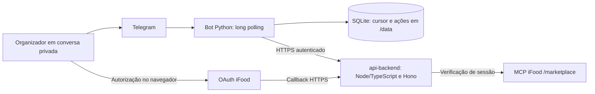

# Arquitetura implementada

Mapa da árvore local em 20/10/2026. O [fluxo de outbox/worker](bot-01-fila-duravel.md) usa o SQLite do bot e as rotas v1 da API. Não duplica domínio nem instala modelo. A conversa é opt-in; configuração/deploy online não foram consultados nesta revisão.

O [assistente](assistente-conversacional.md) usa intenção natural, audiência/memória na API e apresentação progressiva. A [proposta v0](contrato-conversa-proposto.md) e as ações guiadas do intérprete anterior são históricas. CART-01/callback PREPARE_CART têm caminho separado e gates de evidência; integração dessa nova sacola ao canal de revisão ainda exige verificação. Envio/pagamento continuam proibidos.

[Índice](README.md) · [Estado e evidências](estado-atual.md)

## Fronteiras atuais

O diagrama mostra fronteiras, não uma prova de operação online. A conversa acrescenta runner → outbox com sessão capturada → API RUN-01/assistente/memória/DATA-01 → GET/progresso e apresentação. BOT-02 consulta contexto após revalidar vínculo, sem reexecutar mensagem. PREPARE_CART existe em `cart.py`/`cart_client.py`, desligado por padrão; não é envio de pedido. O protótipo FastAPI original é outro serviço.

## Mapa do código

| Módulo | Responsabilidade implementada |
| --- | --- |
| `src/telegram_bot/__main__.py` | CLI, configuração, diagnóstico Telegram, inicialização e encerramento |
| `config.py` | Token Telegram, ID permitido e diretório de estado pelo ambiente |
| `telegram.py` | Transporte Bot API, métodos permitidos, timeout, bloqueio de redirects e erros saneados |
| `runner.py` | Autorização da conversa/remetente, comandos, callbacks, polling e espera progressiva |
| `state.py` | Cursor SQLite, registro prévio de ações e lock de processo no mesmo diretório |
| `backend.py` | Contrato HTTP de login, validação de estados, operações e URL de autorização |
| `connections.py` | Mensagens do fluxo, apresentação da identidade mascarada e botão humano |
| `conversation.py` | Cliente v1.0, sessão da conta, memória, progresso, endereço e cancelamento local |
| `outbox.py` / `conversation_runner.py` | Persistência dos eventos, acompanhamento sem bloquear polling e retomada por consulta |
| `conversation_contract.py` | Documentos imutáveis, schemas fixados e validação semântica de respostas |
| `menu.py` / `runner.py` | Menu inline, controles SELF/remover/limpar e callbacks de uso único |
| `address_flow.py` | Escolha humana do endereço, inclusive quando só existe um |
| `cart.py` / `cart_client.py` / `cart_view.py` | Canal humano PREPARE_CART, cliente estrito e revisão/custos, recuperação por GET com opt-in separado |
| `tests/test_bot.py` | Cenários simulados do canal, transporte, autorização e estado |
| `tests/test_connections.py` | Cenários simulados do contrato, confirmação, replay e falhas |
| `Dockerfile` / `railway.toml` | Imagem Python 3.12 e configuração do worker |

OAuth, MCP, modelo, regras do grupo e escrita de carrinho pertencem à API. O adaptador envia eventos do organizador e apresenta respostas confiáveis; não duplica o domínio nem executa ferramentas iFood diretamente.

O [cliente de conversa](cliente-conversa.md) já está conectado ao runner via outbox BOT-01, com opt-in explícito. Esse código integrado não comprova ensaio humano ponta a ponta. Confirmação de carrinho exige o caminho dedicado CART-01/BOT-03 e nunca é inferida do texto do modelo.

## Contrato HTTP consumido

Origem HTTPS configurada em `BACKEND_BASE_URL`. Headers: `Authorization: Bearer BACKEND_API_TOKEN` e `X-Telegram-User-Id` do organizador validado pelo adaptador. A identidade não vem de texto ou modelo.

| Ação do bot | Método e rota | Efeito |
| --- | --- | --- |
| `/conectar` | `POST /api/bot/ifood/connect` | Nova tentativa de login; pode substituir a anterior |
| `/confirmar` e `/ifood` | `GET /api/bot/ifood/status` | Consulta local do vínculo; `/confirmar` apresenta o botão quando disponível |
| Clique em Confirmar conexão | `POST /api/bot/ifood/confirm` | Envia o `confirmationId` da tentativa atual após validação humana |
| `/verificar` | `POST /api/bot/ifood/verify` | Solicita verificação/renovação ao backend |

BOT-02 consome também POST `/api/bot/ifood/cancel` e DELETE `/api/bot/ifood/link`, com efeitos separados. O callback normal conclui vínculo no navegador; status atualiza a mensagem sem segundo clique. Confirmação manual permanece recuperação. Endereços já são consumidos pelo adaptador; `/api/evaluate` não é seu caminho conversacional principal.

O [cliente atual](cliente-conversa.md) usa `/account-context`, `/memory`, `/events`, `/operations/:id`, `/operations/:id/progress`, snapshot, cancelamento e endereços sob o prefixo da conversa. `X-Conversation-Session` acompanha comandos/eventos associados; `/memory` e endereço têm contratos próprios. O [pin antigo de login](https://github.com/Modo-Escuro/api-backend/blob/686300d1a10c12bb6c3bd899e40fbd3a68c648f5/docs/bot-api.md) é proveniência histórica, não lista atual de rotas.

O timeout HTTP do backend é de 50 segundos nos comandos e 5 segundos nas consultas automáticas; não há retry automático de mutações. O cliente rejeita redirect e link de autorização fora da origem pública configurada ou sem correspondência com a tentativa.

## Estado e repetição

Antes de conexão, verificação, confirmação, cancelamento ou desconexão, o adaptador grava o `update_id` como ação iniciada. Replay do mesmo update consulta o estado em vez de repetir a mutação. O cursor avança após resposta ou descarte autorizado do evento; falha entre envio Telegram e gravação pode repetir mensagem textual.

O `confirmationId` não é persistido no SQLite: vem do status e do callback do botão. Clique antigo não confirma uma tentativa nova. Uso único e validade também dependem da autoridade do backend. O lock protege processos no mesmo diretório; não impede outra máquina de usar o mesmo token.

O SQLite contém cursor, ações, tentativa acompanhada e outbox: texto/comando pendente tem retenção própria; após aceite conhecido, corpo é removido e ficam metadados de recuperação/sessão. Não persiste snapshots, catálogo, texto da prévia, tokens iFood ou referência clara da confirmação CART-01. A memória seletiva fica na API. Não confundir ausência de snapshot local com ausência total de texto pendente. [Retenção](bot-01-fila-duravel.md#retenção-e-d7).

Tokens iFood pertencem à API; volume atual exige conferência antes de redeploy. A reconciliação usa SQLite v6 na API, unificando variantes v5; o banco do bot tem migrações próprias.

## Regras para os próximos incrementos

As garantias de repetição do canal não equivalem à idempotência de um pedido remoto. O contrato de compra deverá vincular intenção, responsável, conta/link, versão, total em centavos e validade; alterações invalidam aprovação. Timeout remoto exige reconciliação antes de reenviar.

Restrições obrigatórias e informação alimentar desconhecida precedem ranking. Catálogo é dado, não instrução. Consulte [regras preservadas](regras-preservadas.md) e [plano da demo](plano-demo.md) antes de implementar novos fluxos.
