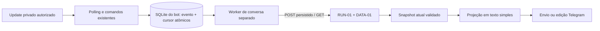

# BOT-01 — Texto livre, outbox e acompanhamento

[Issue #1](https://github.com/Modo-Escuro/telegram-bot/issues/1) · [Cliente v1](cliente-conversa.md) · [Login](login-ifood.md)

**Atualização local de 20/10:** o mesmo fluxo de fila atende o assistente. O cliente captura `/account-context`, conserva sessão na outbox e usa `X-Conversation-Session` em envio/consulta/replay; não transfere mensagem entre contas. [Contrato atual](cliente-conversa.md) e [UX/memória](assistente-conversacional.md). Base/CI/resultados de origem abaixo são históricos; não representam o processador atual nem o estado atual das issues.

## Alcance e base

Implementação sobre os incrementos das PRs #7 (plano), #8 (BOT-02) e #9 (cliente), preservando seus commits.
Os PRs #7/#8/#9 e este incremento foram incorporados à `main@c29cc04` pelo merge da PR #10. Merge não comprova deploy.
O estado observado online em 17/10/2026 permanece separado e não foi revalidado neste incremento.

Backend fixado no ensaio/CI histórico deste incremento: `Modo-Escuro/api-backend@2b77c958f358130c91a72e310d5c31f6c39c2d00`, com RUN-01,
DOM-01 e DATA-01. Seus schemas v1 continuam iguais aos fixados no cliente (`6ce3d99`); não alterar cópias locais
isoladamente. A DATA-01 já persiste compra/participantes/patches e expurga dados no SQLite da API. AI-02 foi
mergeada nessa base, mas não montada no entrypoint daquele pin. O processador local atual é o assistente opt-in; [remoto/local](estado-remoto-local.md) conserva retratos datados. Não mudar pins por esta revisão.
Os testes do incremento original da BOT-01 usaram `d2883f1`; a continuação BOT-02 atualiza a referência para `2b77c95`.

A [DEC-01 vigente](decisoes-conversacionais.md) exige carrinho real após confirmação humana PREPARE_CART; este incremento BOT-01 não instala esse callback. BOT-03 deve apresentar revisão e confirmar pelo caminho dedicado da CART-01, dependente da INT-02 para ativação. `/purchase-approvals` é outra finalidade; envio e pagamento continuam proibidos.

## Fluxo implementado



- O ID do bot vem de `getMe`; usuário/chat vêm do update privado validado. Nada é derivado do modelo.
- A fila local é escopada à origem da API, bot e organizador. Guarda corpo mínimo, não o update integral.
- A identidade do evento combina `update_id` e `message_id`, dentro desse escopo: reinício aleatório de update_id
  após inatividade não confunde uma nova mensagem com a anterior. Mesma identidade com conteúdo diferente conflita.
- Evento recebido e cursor são gravados juntos em `BEGIN IMMEDIATE`, antes de qualquer rede de conversa.
- Uma mensagem por conversa é preparada/enviada de cada vez; mensagens seguintes aguardam em ordem. Não são
  concatenadas nem descartadas. Cada uma obtém a versão atual só antes da primeira preparação do comando.
- Interromper durante a consulta de versão preserva o cancelamento local: a preparação revalida o estado
  dentro da transação e não ressuscita a mensagem removida, inclusive se essa consulta falhar.
- Comando preparado é persistido antes do POST. Depois disso, bytes, versão e origem nunca são reconstruídos.
- O aceite associa `operation_id` e remove corpo/comando local. A consulta passa a usar GET; o texto do resultado
  e snapshots não são persistidos no bot.
- Há uma thread de conversa, com conexão SQLite e clientes HTTP próprios. O polling continua recebendo textos,
  ajuda e callbacks durante chamadas lentas de conversa. Os comandos de login existentes conservam seus próprios
  timeouts e comportamento; não se promete que uma chamada explícita de login nunca ocupe o polling.

## Comandos e respostas

| Comando | Efeito |
| --- | --- |
| Texto livre | Enfileira uma mensagem privada do organizador |
| `/andamento` | Consulta somente metadados locais, sem chamar modelo/API |
| `/interromper` | Remove evento ainda não preparado ou solicita cancelamento local da operação ativa |
| `/retomar` | Libera um novo ciclo limitado de recuperação do mesmo comando/operação; entrega Telegram incerta pode aparecer novamente |
| `/cancelar` | Continua exclusivo da tentativa de login (BOT-02) |
| `/desconectar` | Continua exclusivo do vínculo; não aprova nem cancela compra |

Receber uma correção durante processamento não interrompe automaticamente o turno atual: a correção fica na fila
e usa a versão vigente quando chegar sua vez. Cancelamento é uma ação explícita e tem evento/origem próprios.
Se o aceite do alvo for incerto, primeiro recuperar a identidade da operação; não fabricar outra operação.

Versão antiga não é corrigida silenciosamente em evento enviado. O bot orienta o organizador a enviar nova
correção; a API continua responsável por rejeitar resultados atrasados. Nenhuma mensagem do modelo aprova compra.

As respostas são texto simples (sem `parse_mode`), divididas em até 3500 unidades UTF-16 por parte, sem cortar
emoji. O renderizador só projeta campos conhecidos e omite referências internas, de ação e aprovação. Texto MODEL
é identificado como fala do assistente e não vira confirmação operacional. Custo é apresentado como desconhecido,
estimativa, faixa ou cotação da API; não somar no bot nem trocar `null` por zero. A interface sempre informa que
nenhum pedido é enviado na apresentação inicial; não repete aviso geral em todo rodapé. Avisos específicos permanecem. O resultado atual pode conter correção mais recente que a operação consultada.

## Falhas e recuperação

| Situação | Comportamento |
| --- | --- |
| Queda antes do commit local | O update não foi confirmado pelo cursor; pode ser recebido novamente |
| Queda após commit e antes de POST | Mesmo evento local é recuperado |
| POST sem resposta válida ou timeout | Recuperação explícita pelo worker com os mesmos bytes; API deduplica; não significa replay de escrita MCP |
| Operação aceita antes de reinício | Reabrir a fila e consultar a mesma operação por GET, sem novo POST |
| API indisponível, autenticação recusada ou protocolo inválido | Erros locais fixos, sem corpo remoto; pausa limitada e recuperação orientada |
| Cancelamento local | Nunca anunciado como desfazimento/cancelamento no iFood |
| RESULT_UNKNOWN | Não anunciar sucesso nem repetir compra; orientar reconciliação |
| Telegram 429 | Respeitar `retry_after`; tentativa limitada |
| Telegram 403 | Encerrar a entrega local sem prender indefinidamente a fila |
| Timeout ao criar mensagem ou queda antes de guardar message_id | DELIVERY_UNKNOWN; não reenviar automaticamente; `/retomar` pode duplicar a mensagem, nunca o evento da API |
| Falha ao editar mensagem conhecida | Reusar seu ID; erro 400 ambíguo pausa para recuperação explícita, sem interpretar texto privado do erro |

A entrega no Telegram **não tem garantia de execução única**. Quando o ID é conhecido, a edição e seu hash
evitam repetir partes já confirmadas. O marcador SENDING anterior à chamada protege a janela de crash; só gravar
"entregue" depois da confirmação. Um erro pode ter ocorrido depois do efeito no servidor Telegram.

## Limites técnicos

| Limite | Valor inicial |
| --- | --- |
| Mensagens/controles pendentes antes de recusar novo texto | 10 |
| Registros técnicos por escopo | 10.000, com limpeza dos terminais após 7 dias |
| Corpo serializado aceito | 16 KiB, compatível com a rota da RUN-01 |
| HTTP de conversa / HTTP Telegram no worker | 5 s por chamada |
| Ciclo de recuperação automática | Até 3 falhas, com espera de 5/10/20 s; depois exigir `/retomar` |
| Consulta pendente após deadline informado pela API | Até 30 s de tolerância; depois pausa recuperável |
| Tick do worker | 250 ms; respeita `pollAfterMs` entre consultas pendentes |
| Long polling com conversa habilitada | 3 s |

Fila cheia gera recusa durável sem guardar o texto rejeitado. Ao atingir 10.000 registros, o recebimento informa
recusa; não descarta um evento aceito nem inventa confirmação da API. Falha de SQLite não avança cursor. O worker
falha fechado, sem traceback privado, e o processo principal encerra ao detectar sua falha; a próxima instância
recupera o SQLite. O lock de instância existente continua obrigatório.

## Retenção e D7

- Corpos aguardando envio expiram em 24 h, inclusive quando a primeira consulta de snapshot estava indisponível.
- Ao conhecer a operação aceita, corpo e comando são removidos. Ao terminar a entrega, os hashes/IDs das partes
  são removidos. Restam chave/hash e metadados de deduplicação/recuperação por até 7 dias após a criação.
- Um comando já enviado com aceite incerto não é eliminado por um temporizador: apagá-lo impediria recuperar o
  mesmo evento. Exige recuperação/reconciliação. Não usar nova chave para contornar esse estado.
- Antes de cada parte final, consultar operação e **snapshot atual** da API. Nunca apresentar o snapshot histórico
  guardado dentro de uma operação antiga como se fosse o atual. Os testes de encerramento e expurgo da DATA-01
  comprovam que o bot não reintroduz o grupo apagado.
- Nenhum contrato de ciclo de vida precisou ser inventado: a versão e o snapshot atual da DATA-01 são suficientes
  para esta entrega, pois não há cópia local persistente do domínio/resultado. Isso não implementa exclusão de
  mensagens já entregues no Telegram nem apaga backups do operador.
- SQLite usa WAL, `synchronous=FULL` e `secure_delete`. Remoção lógica não é prova de sanitização de WAL/backups;
  manter volume privado e política operacional D7/OPS-02, incluindo rotação de backups. Comandos incertos e cópias
  operacionais precisam de acompanhamento antes da liberação com dados reais.

## Configuração e rollout

`TELEGRAM_CONVERSATION_ENABLED=false` é o padrão. Nenhuma variável Railway foi alterada neste desenvolvimento.
Se desativado, não criar a fila/worker de conversa e preservar os comandos existentes. Ativação exige backend
configurado, ID do bot cadastrado na API, volume persistente, uma instância, assistente instalado e ensaio humano
controlado. A flag do bot não instala processador na API e não deve ser ligada apenas porque a infraestrutura existe.

Preservar o SQLite atual, inclusive eventuais WAL/SHM, ao migrar; parar o processo para uma cópia consistente.
As tabelas novas são aditivas (`conversation_outbox` e `conversation_delivery`); cursor, ações e login_watch são
preservados. Rollback do código não deve apagar a fila nem iniciar outro polling concorrente. Flag desativada pausa
o worker e sua limpeza automática: uma desativação prolongada exige manutenção privada do estado conforme D7.

## Reprodução e evidência

```text
python -m pip install -r requirements.lock
python -m pip install --no-deps -e .
python -m unittest discover -s tests -v
python -m ruff check src tests
python -m ruff format --check src tests
```

Integração separada: preparar um checkout da API **no commit fixado acima**, instalar seu lockfile com `npm ci
--ignore-scripts`, definir `BOT01_API_ROOT` para esse diretório e executar `test_run01_integration.py`. A fixture é
copiada temporariamente para a raiz desse checkout e removida no fim; exige diretório de ensaio exclusivo. O banco
é temporário. Só as rotas reais de conversa/autenticação/SQLite são usadas; processador, pessoa, credencial e relógio
são sintéticos. A porta é aleatória em `127.0.0.1`; não carrega `.env`, configs pessoais ou tokens reais e não possui
cliente Telegram/MCP/modelo. A CI executa esse job em Windows/Linux com Node 22.13 e Python 3.12.

O job unitário ignora explicitamente os seis testes HTTP quando não há checkout da API; o job de integração os
executa obrigatoriamente. Resultados finais e commit ficam na descrição do PR e na issue. Testes locais/CI não
comprovam deploy nem IA online. O fechamento histórico da BOT-01 refere-se ao alcance registrado no [backlog datado](backlog-conversacional.md), não a todos os ensaios externos. Situação atual no GitHub não foi consultada nesta atualização.
