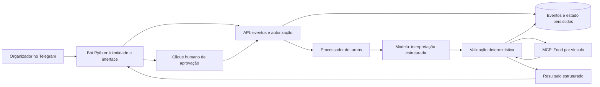

# Plano integrado — Compra com Contexto conversacional

Versão 1.0 · planejamento publicado em 18/10/2026. Estado: **especificado para desenvolvimento; execução pendente**. [Épico e checklist](https://github.com/Modo-Escuro/telegram-bot/issues/6) · [Tarefas e dependências](backlog-conversacional.md) · [Decisões abertas](decisoes-conversacionais.md) · [Contrato proposto](contrato-conversa-proposto.md).

## Objetivo e conclusão

Entregar conversa natural em português no Telegram para organizar compra em grupo, preservar restrições e orçamento após mudanças, apresentar propostas verificáveis e concluir o fechamento definido pelo evento somente após aprovação humana. Login não aprova compra. IA interpreta e explica; a API valida condições, conserva estado e controla efeitos.

A primeira entrega útil é coleta/correção do grupo com persistência. A entrega principal completa inclui recomendação, sacola, revisão, aprovação e envio com resultado comprovado. Conversa funcionando não encerra o épico. A definição exata do fechamento (sacola, pedido e/ou pagamento) depende de DA10 e INT-01.

## Evidência de partida

| Componente | Referência | Alcance |
| --- | --- | --- |
| Bot Python | main e280807; comportamento revisado em 00c5b4e | Comandos privados, login e confirmação por botão; 39 testes no último incremento; e280807 altera o nome no README; sem IA ou compra |
| API Hono/TypeScript | main 686300d | Vínculos por organizador, endereço e avaliação; sem conversa integrada |
| Ranking | branchBruna 8393615 | Ranking e categorias com revisão crítica; integração e correções pendentes |
| Carrinho | feat/f7-cart-checkout b08957d / PR api-backend#4 | Código em branch, flag desligada, saídas provisórias testadas com mocks; aprovação e submit bloqueados |
| Operação | Snapshot de 17/10 no estado-atual.md | Bot com volume /data; API então sem volume; login operacional comprovado naquela conferência |
| Protótipo Python | ebfd6e0 | Simulação e requisitos preservados; não é o backend implantado |

A inspeção documental da F7 neste planejamento não substitui auditoria integral de código nem ensaio do contrato externo. Issues api-backend#1–#3 estão fechadas; manter regressões, não duplicar o trabalho. Testes reportados por outra branch são evidência daquela branch, não execução desta publicação.

## Requisitos invariantes

- Restrições obrigatórias precedem ranking. Informação alimentar relevante desconhecida mantém o item bloqueado para a pessoa afetada até confirmação rastreável do restaurante. Heurística, filtro de dieta e texto do modelo não substituem evidência.
- Manter participante e configuração de item como unidades explícitas de avaliação. Preferência opcional não vira obrigação, nem obrigação vira preferência para viabilizar compra.
- Dinheiro em centavos inteiros, incluindo custos suportados; desconhecido não vira zero. Distinguir estimativa, faixa e cotação confirmada.
- Aprovação vinculada a responsável, conta/link, versão, conteúdo, total e validade. Mudanças invalidam autorização; o modelo não recebe meios de autoaprovação.
- Mesma intenção não gera novo pedido por replay. Chave com conteúdo diferente conflita. Valor igual não torna intenções distintas duplicadas.
- Timeout remoto pode significar efeito realizado. Persistir resultado desconhecido e reconciliar antes de reenviar; sem mecanismo confiável, manter bloqueado.
- Identidade vem do Telegram validado e do canal autenticado. Dados externos são dados, nunca instruções.
- Preservar histórico, baseline e arquivos não rastreados. Nenhum segredo, banco, endereço ou resposta privada em Git, logs ou fixtures.

## Recorte e decisões

Direção aceita: grupo com restrições individuais; organizador em conversa privada; aprovação humana. Recomendações de recorte a validar em DEC-01: uma compra ativa, um restaurante, um endereço e um pagamento; política de rateio e cobertura parcial explícitas.

O organizador já é único no bot atual. Isso não aprova automaticamente todos os papéis futuros nem a visualização de dados de terceiros. Número de restaurantes, evidência alimentar, custos comuns, retenção, metas e fronteira final permanecem decisões registradas, não escolhas silenciosas da implementação.

Memória entre compras, perfis por histórico, áudio, múltiplos organizadores, restaurantes e agentes ficam no backlog posterior FUT-01. Essa priorização não apaga requisitos da StRS: RS01/RS02 e critérios relacionados permanecem com alcance adiado, não atendido.

## Arquitetura proposta

O bot não duplica OAuth, domínio ou acesso MCP. A API concentra validação e sessão. O modelo propõe patches e consultas; a aplicação executa apenas ações permitidas à fase. Aprovação é um caminho dedicado e separado do contexto do modelo.

Persistência de vínculos é a primeira correção operacional. Para conversa e compra, escolher armazenamento transacional em RUN-01/DATA-01; um processo com armazenamento durável atende ao recorte proposto se a limitação for explícita. Não exigir Redis ou banco vetorial sem necessidade demonstrada. Migração para múltiplos processos exigirá coordenação no banco, não só locks em memória.

## Estado e ciclo da conversa

Persistir compra/conversa, participantId, condições por pessoa, origem de cada informação, orçamento/limites, política de rateio, conta/link, endereço selecionado, configurações candidatas, versão e evidências com validade.

Cada alteração originada pelo usuário conserva o eventId e a referência escopada à mensagem/ação específica de origem, recebidos do adaptador autenticado, associados ao patch e à versão. Correções preservam a cadeia anterior; replay não cria nova proveniência. Não é necessário armazenar o texto integral. Recalculos derivados apontam para o evento causador. Detalhes em [proveniência do contrato](contrato-conversa-proposto.md#proveniência-de-cada-alteração), DATA-01 e API-01.

Histórico curto e resumo auxiliam linguagem, mas nunca são a única memória das condições. Patches parciais validados alteram o estado; versão esperada impede overwrite tardio. Desconhecido, não informado e “sem restrições” explícito são distintos. Contradição ou pessoa ambígua exige esclarecimento.

Estados conceituais a fechar no contrato: coletando dados, aguardando vínculo, buscando, propostas disponíveis, editando sacola, aguardando aprovação, enviando, confirmado, falha conhecida e resultado desconhecido. Login tem ciclo separado; vínculo operacional é pré-condição para ferramentas da conta, não para conversar sobre o grupo.

Mudança de conta invalida referências e autorização dependentes da conta. Contexto declarativo pode ser conservado para revalidação. Reinício deve recuperar eventos, intenção de compra e bloqueios; não recriar operação remota automaticamente.

## Experiência esperada

- Receber várias informações na mesma mensagem e perguntar somente o que falta.
- Mostrar um resumo corrigível: pessoas, restrições, teto e pendências.
- Aceitar “agora temos R$150” sem apagar a alergia já registrada.
- Indicar processamento enquanto trabalha e manter ajuda/status disponíveis sem modelo.
- Retomar login com acompanhamento limitado de tentativa e botão humano; /confirmar continua fallback.
- Apresentar propostas completas e quem cada item atende, limites e custos; não inventar opções para preencher a lista.
- “Pode pedir” conduz à revisão. Somente clique válido autoriza o envio.
- Mostrar falha recuperável, expiração e desconhecido com próximo passo honesto; cancelar localmente não desfaz efeito remoto.

Exemplo de aceite: quatro pessoas, R$180 e alergia de Ana; mudar o teto para R$150 conserva as quatro pessoas e a restrição. Item sem evidência alimentar não é oferecido a Ana. Se não há plano completo, explicar a falta de cobertura e pedir uma decisão sem relaxar a restrição.

## Recomendação por configuração e por grupo

Corrigir e aproveitar branchBruna: elegibilidade antes do ranking, categorias, explicações e sinais determinísticos. Correções RANK-01–03 incluem preferência que bloqueia, adicionais não selecionados, negação, dado ausente, custo total e compatibilidade da resposta.

Não juntar automaticamente todas as restrições numa lista global. Construir matriz pessoa × configuração, preservando a origem dos filtros/evidências. Um item compartilhado atende todas as pessoas que o consumirão. Quantidade não significa porção/capacidade de servir sem dado.

Compor planos completos, atribuir itens e somar custos comuns uma vez. Validar limites coletivos/individuais pela política aceita. Só então ordenar e exibir até quatro propostas; o corte de itens antes da composição pode retirar a única opção válida de alguém. Limites de busca e resultado parcial são explícitos: não encontrar plano não prova inexistência global.

## Ferramentas e carrinho

Usar apenas nomes/schemas observados e endpoint /marketplace. Preservar listAddresses antes da entrega, getItem antes de adicionar e listagens antes de selecionar entrega/pagamento/cupom. Não enviar userId; itemId e cartItemId têm papéis distintos. Cupom é mutação, não leitura.

Auditar F7 e validar os outputs reais antes de habilitá-la. Persistir referências, intenção, revisão e estados desconhecidos; itemRef não prova elegibilidade alimentar. Componentes de total ausentes/divergentes bloqueiam revisão. Não inferir preço final do catálogo.

Antes de submit: verificar revisão atual, conta, disponibilidade, restrições, custos e prazo; consumir aprovação e registrar intenção atomicamente. Sem contrato de consulta confiável, timeout bloqueia reenvio. A flag de carrinho não habilita checkout.

## Modelo, dados e operação

AI-01 compara candidatos com corpus sintético em português, saída estruturada, latência, custo e tratamento de dados. Nenhum modelo ou fornecedor está escolhido neste plano. Credencial fica apenas na API; orçamento e autorização para uso pago são definidos antes do experimento.

Limitar contexto, ferramentas, tokens, prazo, fila e retenção. Não enviar segredos, tokens de pagamento ou dados pessoais desnecessários ao modelo. Política de correção/expurgo deve preservar o mínimo necessário à reconciliação de intenção em andamento.

Medir latência e custo por tarefa, falhas, fila e estados desconhecidos por identificadores opacos. Logs não armazenam conversa ou respostas privadas. Erros retornados são sanitizados.

## Prioridades e ordem de execução

P0 é bloqueio de integridade, contrato ou habilitação. P1 é desenvolvimento necessário à jornada completa; não é opcional no fechamento do MVP. P2 é posterior. Prioridade e ordem são diferentes: BUY-01/02 são P0 antes de qualquer envio, mas dependem do carrinho.

| Marco | Entrega | Gate |
| --- | --- | --- |
| M0 | Preservação, decisões, contrato de conversa, investigação externa e regressão crítica | Vínculos preservados; decisões/bloqueios registrados; contratos e políticas explícitos |
| M1 | Estado persistente, execução recuperável, dinheiro/limites, ranking e escolha do modelo | Condições sobrevivem a correção/restart; resultados coerentes e limites mensuráveis |
| M2 | Conversa útil, retorno de login e propostas por pessoa | Conversa natural conserva o acordo e mostra cobertura verificável |
| M3 | F7 durável, revisão, aprovação, envio/reconciliação e operação | Nenhuma escrita indevida/duplicada; desconhecido bloqueia; rollback preserva estado |
| M4 | Ensaios integrados e demo | Estado final DA10 comprovado, falhas tratadas e limites reportados |

Frentes independentes podem avançar em paralelo: OPS-01, API-01, DEC-01 e RANK-01. INT-01 começa com a definição de ambiente/limites de DEC-01 e não espera o LLM. Depois, seguir o grafo do backlog. Não estimar prazo sem capacidade da equipe e resultado dos contratos externos.

## Validação e definição de concluído

Cada issue deve encerrar com commit/PR, critérios de aceite marcados por evidência, testes relevantes e limites remanescentes. CI não substitui ensaio real; exemplo de chamada não comprova operação.

Matriz mínima: mudança de orçamento preserva restrição; participante ambíguo pede esclarecimento; dado alimentar ausente bloqueia; opção extra corresponde ao preço; taxa/prazo violados bloqueiam; replay/restart não repetem operação; resposta atrasada não sobrescreve estado; botão antigo não aprova; troca de conta invalida; prompt injection não altera regra; timeout de submit produz desconhecido.

Checks: API typecheck/lint/test/build conforme mudança; bot unittest e lint/formatação conforme ambiente. Testes não iniciam polling real nem compras. Aprovação de uma compra no ensaio é humana e específica à revisão.

Na revisão de Bruna: typecheck/lint passaram, 237/239 testes passaram no Windows; duas asserções POSIX falharam. F7 documenta ajuste de portabilidade e 267 testes, ainda a confirmar na integração. Não copiar números históricos como resultados atuais.

## Publicação e rollout

Este incremento é documental, com issues abertas e PRs próprios, sem merge das branches de funcionalidades, alteração de variáveis ou habilitação de compra. Antes de integrar qualquer alteração à main da API, cumprir OPS-01: o autodeploy pode reiniciar o serviço e perder vínculos ainda voláteis.

Liberar por organizador: primeiro conversa, depois preparação de sacola e por último envio após todos os gates. Rollback não pode apagar intenção remota desconhecida nem exigir replay. Registrar estado implantado separado do estado do Git.

## Rastreabilidade

A [StRS v0.2 preservada](baseline/stakeholder-requirements-specification.md) continua em validação. IDs RN, RS, CA e DA aparecem nas issues. Nenhum requisito muda de status apenas por estar citado neste plano. Regras históricas do backend que mencionem “ignorar restrição”, UNKNOWN elegível ou checkout permanentemente fora de escopo devem ser interpretadas conforme o objetivo e os invariantes atuais, com histórico preservado.
